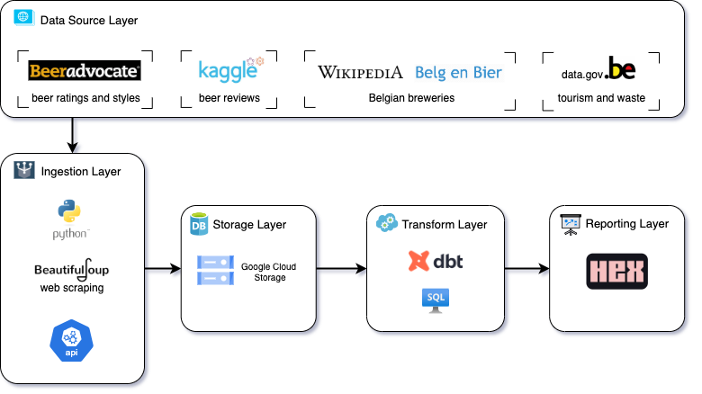
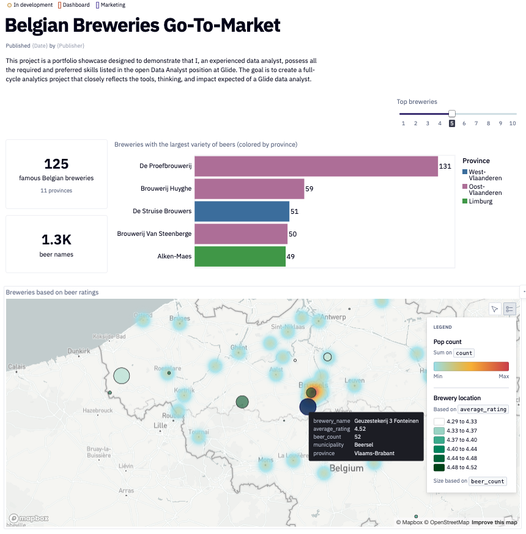

# 🍻 Belgian Beers and Breweries Go-To-Market

**Running go‑to‑market pipeline using scraped + structured beer industry data.  
Built for showcasing data analysis skills in Python → BigQuery → dbt → Hex → Actionable Insights.**


---

## 🎯 Project Overview

Sourcing Belgian beer data to identify potential partnership regions, high-quality breweries, and strategic recommendations—just like Glide would segment users or target expansion regions.

---

## 📁 Architecture Diagram



---

## 🚦 Data Sources

- **BeerAdvocate**: ratings, styles, brewery names, ABV
- **Kaggle – Beers & Reviews**: clean dataset of beer reviews
- **Belgenbier / Wikipedia**: list of 500+ Belgian breweries with province and 2000+ beers
- **Data.gov.be CKAN API**: optional enrichment using tourism or waste data

---

## ⚙️ Kaggle API

To use the Kaggle API, you need to authenticate your requests with an API token. This is done by downloading a `kaggle.json` file containing your credentials.

**Generating your API Token:**  
1. Log in to your Kaggle account.
1. Go to your user profile and select the "Account" tab.
1. Scroll down to the "API" section and click on "Create New API Token".
1. This will trigger the download of the `kaggle.json` file.

**Placing the `kaggle.json` file:**  
The Kaggle API client expects this file to be in a specific location.

- **For Linux, macOS, and other UNIX-based systems**: Place the `kaggle.json` file in the `~/.kaggle/` directory. You may need to create this directory first.  
```bash
mkdir ~/.kaggle
mv /path/to/your/downloads/kaggle.json ~/.kaggle/
```

- **For Windows:** Place the `kaggle.json` file in the `C:\Users\<Your-Username>\.kaggle\` directory. You might need to create the .kaggle folder.

**Verifying Your Setup from the Terminal**

To quickly confirm that your Kaggle API is set up correctly, open your terminal or command prompt and run the following command:  
```bash
kaggle competitions list
```

Common Errors:
- `kaggle: command not found`: This error means the location of the kaggle executable is not in your system's `PATH`. You may need to add it. For Linux and macOS, this is often `~/.local/bin`. For Windows, it's typically in your Python Scripts folder.
- `OSError: Could not find kaggle.json.`: This indicates that your `kaggle.json` file is not in the correct directory. For Linux and macOS, it should be in `~/.kaggle/`. For Windows, it should be in `C:\Users\<Your-Username>\.kaggle\`.
- `401 - Unauthorized`: This error means there's an issue with your API credentials in the `kaggle.json` file. You may need to generate a new token from the Kaggle website.

## 📊 Hex Dashboard

The Hex dashboard provides an interactive interface for users to explore the brewery data, filter by breweries with the largest variety of beers, and gain insights into potential partnerships.



---

## 🧪 Project Structure

```bash
belgian-brewery/
├── README.md
├── architecture_diagram.png
├── bebrew/
│   ├── models/
│   │   ├── staging/
│   │   │   ├── webscrape/
│   │   │   │   ├── _webscrape__models.yml
│   │   │   │   └── ...
│   │   └── ...
├── data/
│   ├── kaggle_beer_reviews.csv
│   ├── belgenbier.csv
│   ├── wikipedia_breweries.csv
│   └── beeradvocate_ratings.csv
├── src/
│   ├── __init__.py
│   ├── ingest/
│   │   ├── __init__.py
│   │   ├── beeradvocatescraper.py
│   │   ├── belgenbierscraper.py
│   │   └── kagglescraper.py
│   ├── transform/
│   │   ├── __init__.py
│   │   ├── bigquery_loader.py
│   │   ├── geodata_catcher.py
│   │   ├── llm_geocoder.py
│   │   └── wiki_brewery_cleaner.py
│   └── util/
│       ├── __init__.py
│       └── ...
├── notebook/
├── dashboard/
├── requirements.txt
├── .gitignore
├── .env
└── LICENSE
```

---

## ⚙️ Run the Pipeline

Quick start:

```bash
git clone https://github.com/sam0per/belgian-brewery.git
cd belgian-brewery
python3 -m venv venv
source venv/bin/activate
pip install -r requirements.txt

# Start data ingestion:
python src/ingest/beeradvocatescraper.py
python src/ingest/belgenbierscraper.py
python src/ingest/kagglescraper.py

# Add geolocation data:
python src/transform/geodata_catcher.py
python src/transform/llm_geocoder.py
python src/transform/wiki_brewery_cleaner.py

# Load data into BigQuery:
python src/transform/bigquery_loader.py

# Run transformations in dbt:
cd bebrew
dbt run
dbt test

# Generate dbt documentation:
dbt docs generate
dbt docs serve
```
